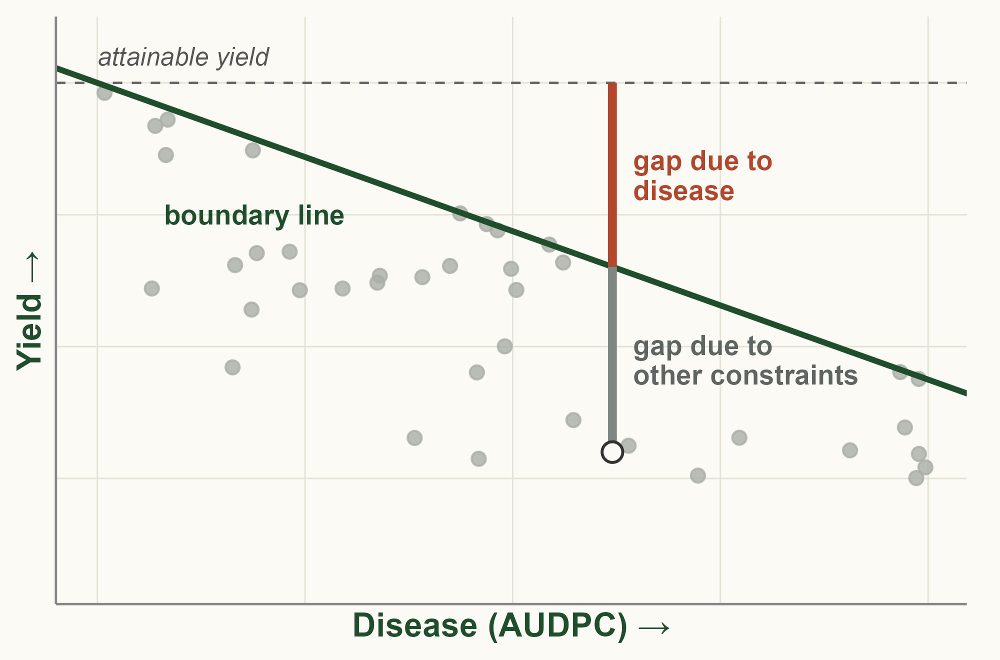
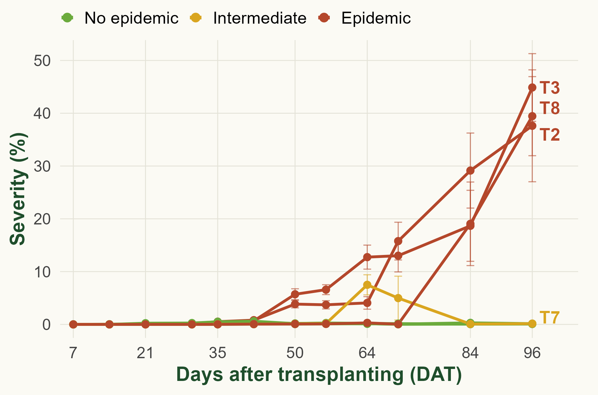
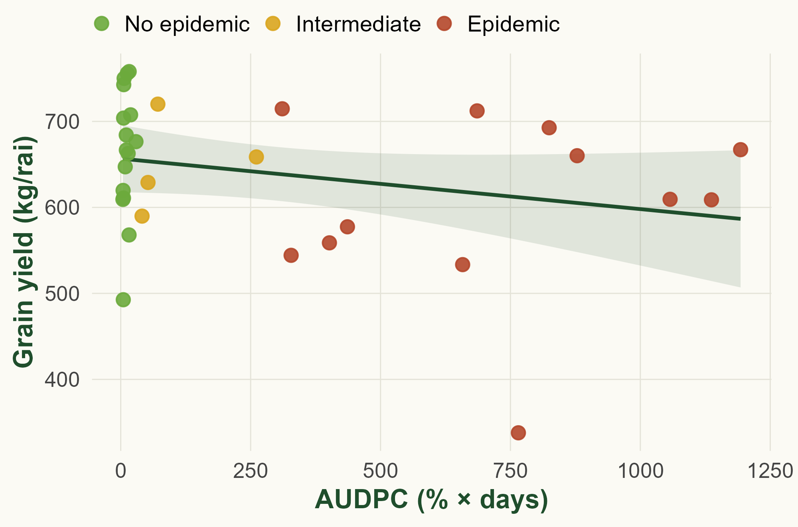
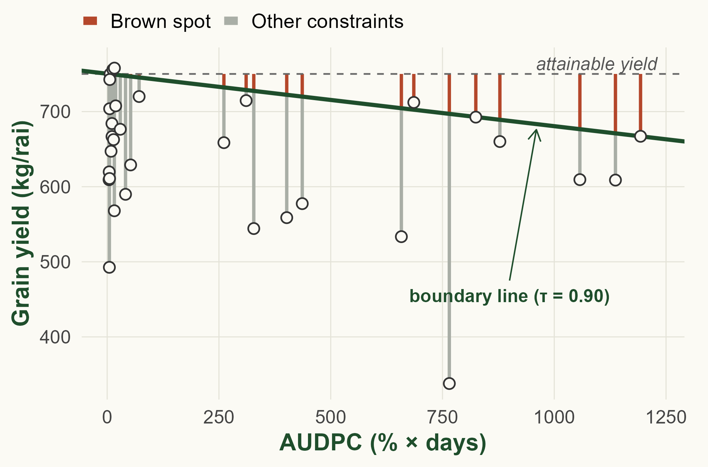
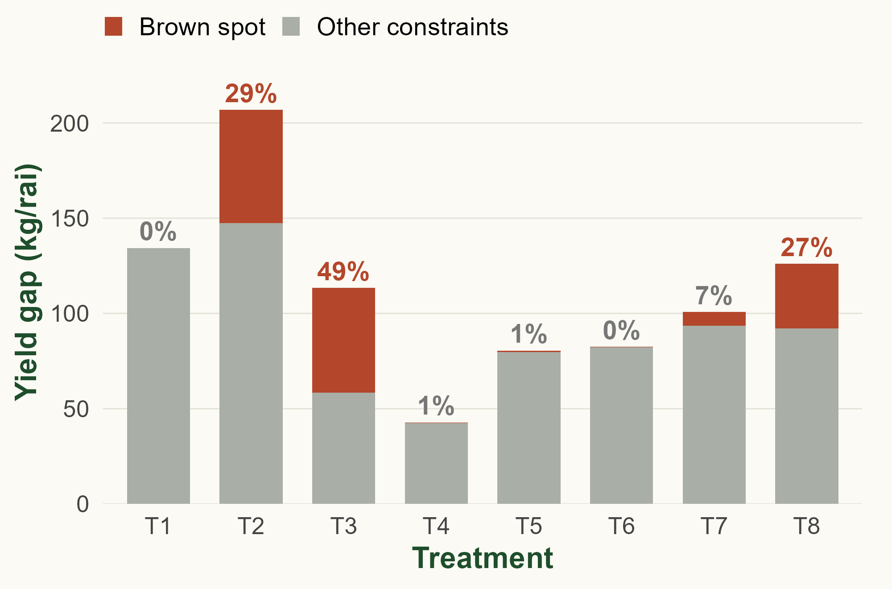

## About Me

:::: {.columns}
::: {.column width="32%" .text-center}
{.profile-photo}
:::
::: {.column width="68%"}
### Kanthanawit Jaisong

[Pathum Thani Rice Research Center, Rice Department]{.muted}

- **Position:** [your position]
- **Research interests:** plant disease epidemiology, crop loss assessment, [...]
- **Tools:** R, Quarto, [...]
- **Contact:** [email]
:::
::::

::: {.notes}
Keep this under 30 seconds.
:::

## Field trials often hide what brown spot really costs

::::: {.cards}
:::: {.card}
[The disease]{.card-title}

Brown spot (*Bipolaris oryzae*) can reduce rice yield

[Savary et al., 2000]{.cite}
::::
:::: {.card}
[The need]{.card-title}

Yield-loss assessment relies on the **disease–yield relationship**

[Madden et al., 2007]{.cite}
::::
:::: {.card .card-alert}
[The problem]{.card-title}

In the field, [other unmeasured factors]{.hl} also limit yield → OLS often finds no relationship

[Madden & Paul, 2009]{.cite}
::::
:::::

::: {.notes}
Problem: the disease effect is masked by other constraints.
:::

## A boundary line isolates the disease effect

:::: {.columns}
::: {.column width="42%"}
- Most plots yield **below** the ceiling because of other constraints
- The **upper edge** shows yield limited mainly by disease
- Fit it with quantile regression, τ = 0.90
- Then split each plot's gap: **disease** + **other**

[Cade & Noon, 2003; Miti et al., 2024]{.cite}
:::
::: {.column width="58%"}
{width=100%}
:::
::::

::: {.notes}
The figure is a schematic with simulated points, not our data.
:::

## Objectives

::::: {.cards}
:::: {.card .card-num}
[1]{.num}

Describe brown spot **development** under different inoculation treatments
::::
:::: {.card .card-num}
[2]{.num}

Analyze the **disease–yield relationship**
::::
:::: {.card .card-num .card-key}
[3]{.num}

Apply BLA to estimate the **yield gap caused by the disease**
::::
:::::

## Materials and Methods {.section-slide data-num="01" background-image="images/brown_spot_bg.jpg" background-opacity="0.35" background-color="#1F4E2C"}

## Eight inoculation regimes created a range of disease

:::: {.columns}
::: {.column width="46%"}
- Sakon Nakhon Rice Research Center, 2026
- Variety **Pathum Thani 1**, transplanted
- **8 treatments × 4 reps = 32 plots**
- Severity scored 12 times, 7–96 DAT
- Yield at 14% moisture
:::
::: {.column width="54%" .small-table}
| | *B. oryzae* inoculation |
|:-:|:--|
| T1 | Not inoculated (control) |
| T2 | 10⁵ spores/mL, every 7 d, 10–70 DAT |
| T3 | 10⁷ spores/mL, every 7 d, 10–70 DAT |
| T4 | 10⁷, once at 10 DAT |
| T5 | 10⁷, once at 15 DAT |
| T6 | 10⁷, once at 30 DAT |
| T7 | 10⁷, once at 50 DAT |
| T8 | 10⁷, once at 70 DAT |
:::
::::

::: {.notes}
12 hills per plot x 10 leaves, Aluko (1970) scale. Harvest area 6 m2. Spacing 20 x 20 cm.
:::

## From leaf scores to yield gap

```{=html}
<div class="workflow"><div class="step "><b>Leaf scores</b><br>0–9 scale<span class="fn">12 hills × 10 leaves</span></div><div class="arrow">→</div><div class="step "><b>Severity %</b><br>class midpoint<span class="fn"><code>ses_to_pct</code></span></div><div class="arrow">→</div><div class="step "><b>AUDPC</b><br>trapezoidal rule<span class="fn">12 dates, 7–96 DAT</span></div></div>
<div class="workflow-down">↓</div>
<div class="workflow"><div class="step grey"><b>OLS</b><br>mean relationship<span class="fn"><code>lm()</code></span></div><div class="arrow">vs.</div><div class="step key"><b>Boundary line</b><br>upper edge, τ = 0.90<span class="fn"><code>BLA::blqr()</code></span></div><div class="arrow">→</div><div class="step key"><b>Yield gap</b><br>disease vs. other<span class="fn"><code>predictBL()</code></span></div></div>
```

::: {.text-center .muted}
R 4.6.0 · tidyverse · BLA · quantreg · plot = experimental unit (*n* = 32)
:::

## Results {.section-slide data-num="02" background-image="images/brown_spot_bg.jpg" background-opacity="0.35" background-color="#1F4E2C"}

## Disease split into two groups, and came late

:::: {.columns}
::: {.column width="60%"}
{width=100%}
:::
::: {.column width="40%"}
- [**No epidemic**]{style="color:#4E8A2A"}: T1, T4, T5, T6 (final ≤ 0.14%)
- [**Epidemic**]{style="color:#B4472B"}: T2, T3, T8 (final 38–45%)
- 71–99% of AUDPC came after 70 DAT → [late-season epidemic]{.hl}

::: {.how}
`audpc <- sum(diff(dat) * (head(sev,-1) + tail(sev,-1)) / 2)`
:::
:::
::::

::: {.notes}
Epidemic timing follows the inoculation schedule, so it cannot be separated from crop age. T7 peaked at 9% then declined.
:::

## OLS: the average misses the effect

:::: {.columns}
::: {.column width="60%"}
{width=100%}
:::
::: {.column width="40%"}
- Slope −0.0587 kg/rai per AUDPC unit
- *r* = −0.260, [*P* = 0.151]{.hl}
- Disease-free plots alone range 493–758 kg/rai → other constraints dominate

::: {.how}
`lm(yield_kg_rai ~ audpc, data = plots)`
:::
:::
::::

## The upper edge of yield declines with disease

:::: {.columns}
::: {.column width="60%"}
{width=100%}
:::
::: {.column width="40%"}
$$\text{Yield} = 750.5 - 0.0699\,\text{AUDPC}$$

- Permutation [*P* = 0.068]{.hl}
- Bootstrap 95% CI: −0.113 to −0.013
- ⚠ Line set by 2 plots

::: {.how}
`BLA::blqr(x = audpc, y = yield, tau = 0.90)`
:::
:::
::::

::: {.notes}
Line defined by T4R1 and T2R4; only 3 plots lie above it, so the CI is likely too narrow. Slope stable across tau 0.80-0.95 (-0.054 to -0.070).
:::

## Brown spot explains one third of the yield gap

:::: {.columns}
::: {.column width="58%"}
{width=100%}
:::
::: {.column width="42%"}
::: {.stat-card}
[33.2%]{.big-number}

of the yield gap in epidemic plots (T2, T3, T8)

[95% CI 7.7–56.0%]{.stat-ci}
:::

- All 32 plots: **17.7%** of the gap
- ≈ **6.6%** of attainable yield

::: {.how}
`yg_disease <- y_att - bl`
:::
:::
::::

::: {.notes}
Epidemic plots: 49.4 kg/rai from disease. All plots: 19.6 of 110.9 kg/rai. Low end of reported losses, 4-52% (Barnwal et al., 2013).
:::

## Treat this as a preliminary estimate

1. Yield below the line is attributed entirely to other constraints
2. The boundary line is sensitive to 2 plots
3. High treatment-level SEM (*n* = 4) → magnitude only, not treatment comparison
4. "Epidemic plots" were chosen after seeing the data
5. Valid only for this variety, season, and site

## Conclusions

::::: {.cards}
:::: {.card}
[Disease]{.card-title}

Inoculation produced **two disease groups**, with a **late-season** epidemic
::::
:::: {.card .card-grey}
[OLS]{.card-title}

**Did not detect** a disease–yield relationship (*P* = 0.151)
::::
:::: {.card .card-key}
[Boundary line]{.card-title}

Brown spot may account for ~[one third]{.hl} of the yield gap in epidemic plots
::::
:::::

::: {.future}
**Next steps:** continuous disease gradient (graded fungicide levels) · multiple seasons/sites · random-coefficients mixed model · earlier inoculation
:::

## Thank You {.section-slide background-image="images/brown_spot_bg.jpg" background-opacity="0.35" background-color="#1F4E2C"}

Questions?

::: {.notes}
Possible questions: plot layout (block effect not significant, P = 0.747); why T7 severity declined; kg/ha = kg/rai × 6.25
:::

## Backup: Data analysis details {visibility="uncounted"}

- R 4.6.0; experimental unit = plot (*n* = 32)
- **OLS** + Pearson: yield vs. AUDPC, final severity, maximum severity
- **Boundary line** (BLA, quantreg) at τ = 0.90

$$\text{Upper-bound yield} = \beta_0 + \beta_1 \times \text{AUDPC}$$

- Permutation test (5,000) · pairs bootstrap (2,000) · sensitivity to τ = 0.80–0.95
- Yield gap: $YG_{total} = y_{att} - y_i$, $\;YG_x = y_{att} - y_{BL}(x_i)$, $\;YG_{other} = YG_{total} - YG_x$

## Backup: Severity and AUDPC {.code-slide visibility="uncounted"}

```{.r code-line-numbers="false"}
# Aluko (1970) score -> midpoint % leaf area (Chiang et al., 2017)
ses_to_pct <- c("0" = 0, "1" = 0.5, "3" = 3, "5" = 15.5, "7" = 38, "9" = 75)

# plot severity = mean over 12 hills x 10 leaves
sev <- mean(ses_to_pct[as.character(score)])

# AUDPC: trapezoidal rule over 12 assessments (7-96 DAT)
audpc <- sum(diff(dat) * (head(sev, -1) + tail(sev, -1)) / 2)
```

## Backup: Boundary line and yield gap {.code-slide visibility="uncounted"}

```{.r code-line-numbers="false"}
# quantile regression at tau = 0.90 -> upper edge of the cloud
fit <- BLA::blqr(x = plots$audpc, y = plots$yield_kg_rai,
                 model = "blm", tau = 0.90)       #> 750.5 - 0.0699 * AUDPC

bl    <- BLA::predictBL(fit, plots$audpc)     # line value at each plot's AUDPC
y_att <- max(bl)                              # attainable yield = 750.2

yg_total   <- pmax(0, y_att - yield)          # total gap
yg_disease <- pmin(y_att - bl, yg_total)      # due to brown spot
yg_other   <- yg_total - yg_disease           # other constraints

100 * mean(yg_disease) / mean(yg_total)       # share of gap from disease
```

## Backup: Inference on the slope {.code-slide visibility="uncounted"}

```{.r code-line-numbers="false"}
# Permutation test (5,000): shuffle yield across plots, H0: no relationship
perm <- map_dbl(1:5000, \(i) {
  d <- mutate(plots, yield_kg_rai = sample(yield_kg_rai))
  coef(rq(yield_kg_rai ~ audpc, tau = 0.90, data = d))[[2]]
})
p_one_sided <- (1 + sum(perm <= obs_slope)) / (5000 + 1)   #> 0.068

# Pairs bootstrap (2,000): resample plots with replacement
boot <- map_dbl(1:2000, \(i) {
  db <- slice_sample(plots, n = 32, replace = TRUE)
  coef(rq(yield_kg_rai ~ audpc, tau = 0.90, data = db))[[2]]
})
quantile(boot, c(0.025, 0.975))                            #> -0.113, -0.013
```
