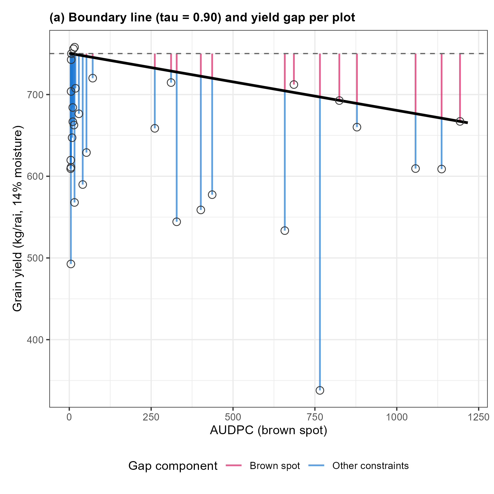
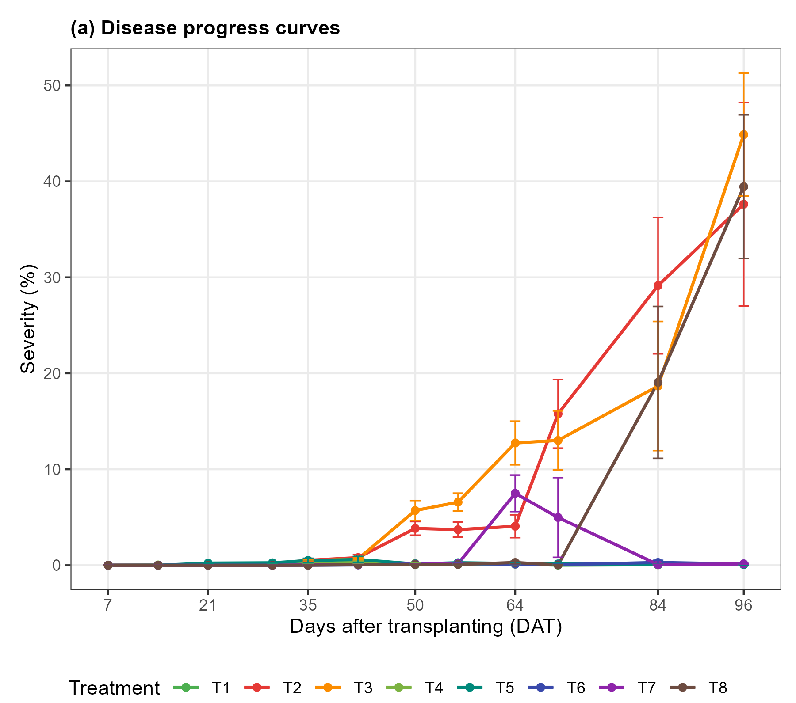
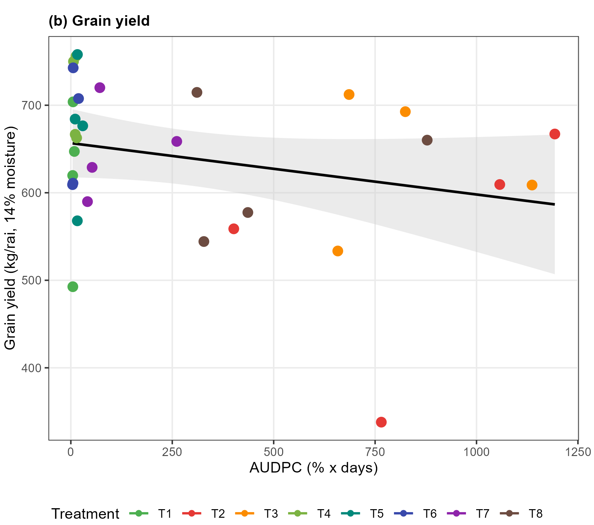
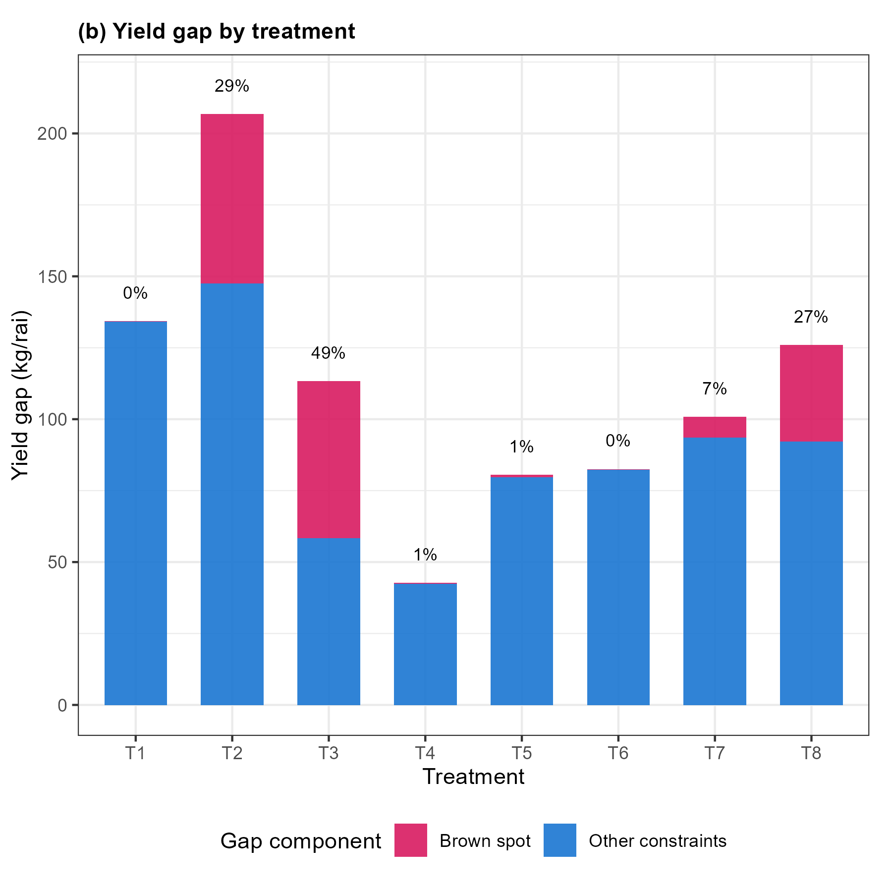

## About Me

:::: {.columns}
::: {.column width="32%" .text-center}
{.profile-photo}
:::
::: {.column width="68%"}
### Kanthanawit Jaisong

[Pathum Thani Rice Research Center, Rice Department]{.muted}

- **Position:** [your position]
- **Research interests:** plant disease epidemiology, crop loss assessment, [...]
- **Tools:** R, Quarto, [...]
- **Contact:** [email]
:::
::::

::: {.notes}
Keep this under 30 seconds.
:::

## Background

- Brown spot (*Bipolaris oryzae*) can reduce rice yield (Savary et al., 2000)
- Yield loss assessment relies on the **disease–yield relationship** (Madden et al., 2007)
- In the field, yield is also limited by [other unmeasured factors]{.hl} → OLS often finds no relationship (Madden & Paul, 2009)

::: {.notes}
Problem: the disease effect is masked by other constraints.
:::

## Concept: Boundary Line

:::: {.columns}
::: {.column width="55%"}
- Most points lie **below** the attainable level because of other constraints
- Points on the **upper edge** = yield limited mainly by disease
- Estimated by quantile regression at τ = 0.90 (Cade & Noon, 2003)
- Partition the yield gap → **disease** + **other constraints** (Miti et al., 2024)
:::
::: {.column width="45%"}
{width=100%}
:::
::::

## Objectives

1. Describe brown spot development under different inoculation treatments
2. Analyze the disease–yield relationship
3. Apply BLA to estimate the [yield gap caused by the disease]{.hl}

## Materials and Methods {.section-slide background-image="images/brown_spot_bg.jpg" background-opacity="0.35" background-color="#1F4E2C"}

## Field Experiment

:::: {.columns}
::: {.column width="50%"}
- Sakon Nakhon Rice Research Center, Feb–Sep 2026
- Variety **Pathum Thani 1**, transplanted at 20 × 20 cm
- **8 treatments × 4 replications = 32 plots**
- Disease assessed 12 times (7–96 DAT); 12 hills/plot × 10 leaves; Aluko (1970) scale
- Yield from 6 m², adjusted to 14% moisture
:::
::: {.column width="50%" .small-table}
| | *B. oryzae* inoculation |
|:-:|:--|
| T1 | Not inoculated (control) |
| T2 | 10⁵ spores/mL, every 7 d, 10–70 DAT |
| T3 | 10⁷ spores/mL, every 7 d, 10–70 DAT |
| T4 | 10⁷, once at 10 DAT |
| T5 | 10⁷, once at 15 DAT |
| T6 | 10⁷, once at 30 DAT |
| T7 | 10⁷, once at 50 DAT |
| T8 | 10⁷, once at 70 DAT |
:::
::::

## Data Analysis

- R 4.6.0; experimental unit = plot (*n* = 32)
- **OLS** + Pearson: yield vs. AUDPC, final severity, maximum severity
- **Boundary line** (BLA, quantreg) at τ = 0.90

$$\text{Upper-bound yield} = \beta_0 + \beta_1 \times \text{AUDPC}$$

- Permutation test (5,000) · pairs bootstrap (2,000) · sensitivity to τ = 0.80–0.95
- Yield gap: $YG_{total} = y_{att} - y_i$, $\;YG_x = y_{att} - y_{BL}(x_i)$, $\;YG_{other} = YG_{total} - YG_x$

## Analysis Workflow

```{=html}
<div class="workflow"><div class="step "><b>Leaf scores</b><br>0–9 scale<span class="fn">12 hills × 10 leaves</span></div><div class="arrow">→</div><div class="step "><b>Severity %</b><br>class midpoint<span class="fn"><code>ses_to_pct</code></span></div><div class="arrow">→</div><div class="step "><b>AUDPC</b><br>trapezoidal rule<span class="fn">12 dates, 7–96 DAT</span></div></div>
<div class="workflow-down">↓</div>
<div class="workflow"><div class="step grey"><b>OLS</b><br>mean relationship<span class="fn"><code>lm()</code></span></div><div class="arrow">vs.</div><div class="step key"><b>Boundary line</b><br>upper edge, τ = 0.90<span class="fn"><code>BLA::blqr()</code></span></div><div class="arrow">→</div><div class="step key"><b>Yield gap</b><br>disease vs. other<span class="fn"><code>predictBL()</code></span></div></div>
```

::: {.text-center .muted}
R 4.6.0 · tidyverse · BLA · quantreg · plot = experimental unit (*n* = 32)
:::

## Results {.section-slide background-image="images/brown_spot_bg.jpg" background-opacity="0.35" background-color="#1F4E2C"}

## Disease Progress

::: {.panel-tabset}
### Result

:::: {.columns}
::: {.column width="62%"}
{width=100%}
:::
::: {.column width="38%"}
- **No epidemic**: T1, T4, T5, T6 (final ≤ 0.14%)
- **Severe**: T2, T3, T8 (final 37.6–44.9%)
- T7 intermediate
- 71–99% of AUDPC after 70 DAT → [late-season epidemic]{.hl}
:::
::::

### How we did it

:::: {.columns}
::: {.column width="55%"}
```{.r code-line-numbers="false"}
# score -> midpoint % leaf area
ses_to_pct <- c("0"=0, "1"=0.5, "3"=3,
                "5"=15.5, "7"=38, "9"=75)

# plot severity = mean of 120 leaves
sev <- mean(ses_to_pct[score])

# AUDPC: trapezoidal rule, 12 dates
audpc <- sum(diff(dat) *
  (head(sev, -1) + tail(sev, -1)) / 2)
```
:::
::: {.column width="45%"}
$$\text{AUDPC} = \sum_{i} \frac{y_i + y_{i+1}}{2}\,(t_{i+1} - t_i)$$

[Aluko (1970) scale; midpoints after Chiang et al. (2017)]{.muted}
:::
::::
:::

::: {.notes}
Epidemic timing follows the inoculation schedule, so it cannot be separated from crop age.
:::

## OLS: The Average Misses the Effect

::: {.panel-tabset}
### Result

:::: {.columns}
::: {.column width="62%"}
{width=100%}
:::
::: {.column width="38%"}
*b* = −0.0587 kg/rai per AUDPC

*r* = −0.260, [*P* = 0.151]{.hl}

Disease-free plots: 493–758 kg/rai (CV 11.1%) → [other constraints dominate]{.hl}
:::
::::

### How we did it

```{.r code-line-numbers="false"}
# one row per plot (n = 32): AUDPC + yield (14% moisture)
m_ols <- lm(yield_kg_rai ~ audpc, data = plots)
summary(m_ols)
#> audpc  -0.0587   P = 0.151

cor.test(plots$yield_kg_rai, plots$audpc)   #> r = -0.260
```
:::

## Boundary Line: Fit the Upper Edge

::: {.panel-tabset}
### Result

:::: {.columns}
::: {.column width="62%"}
{width=100%}
:::
::: {.column width="38%"}
$$\text{Yield} = 750.5 - 0.0699\,\text{AUDPC}$$

- Permutation [*P* = 0.068]{.hl}
- Bootstrap 95% CI: −0.113 to −0.013
- Stable across τ 0.80–0.95

[⚠ Line set by 2 plots (T4R1, T2R4)]{.muted}
:::
::::

### How we did it

```{.r code-line-numbers="false"}
# quantile regression at tau = 0.90 -> upper edge of the cloud
fit <- BLA::blqr(x = plots$audpc, y = plots$yield_kg_rai,
                 model = "blm", tau = 0.90)
#> yield = 750.5 - 0.0699 * AUDPC

# blqr() gives no SE / P -> same line with quantreg::rq()
quantreg::rq(yield_kg_rai ~ audpc, tau = 0.90, data = plots)
# + permutation test (5,000) and pairs bootstrap (2,000)
```
:::

## Partitioning the Yield Gap

::: {.panel-tabset}
### Result

:::: {.columns}
::: {.column width="62%"}
{width=100%}
:::
::: {.column width="38%"}
- *y*~att~ = 750.2 kg/rai
- [Pink]{style="color:#D81B60;font-weight:700"} = brown spot
- [Blue]{style="color:#1976D2;font-weight:700"} = other constraints
- Disease share: 27–49% in T2, T3, T8; < 1% in healthy plots
:::
::::

### How we did it

```{.r code-line-numbers="false"}
bl    <- BLA::predictBL(fit, plots$audpc)     # line value at each plot's AUDPC
y_att <- max(bl)                              # attainable yield = 750.2

yg_total   <- pmax(0, y_att - yield)          # total gap
yg_disease <- pmin(y_att - bl, yg_total)      # due to brown spot
yg_other   <- yg_total - yg_disease           # other constraints

100 * mean(yg_disease) / mean(yg_total)       # share of gap from disease
```
:::

## Yield Gap Due to Brown Spot

:::: {.columns}
::: {.column width="50%"}
[33.2%]{.big-number}

of the total yield gap in epidemic plots (T2, T3, T8)

[95% CI 7.7–56.0%]{.muted}
:::
::: {.column width="50%"}
- *y*~att~ = 750.2 kg/rai
- All 32 plots: disease = **17.7%** of the gap (19.6 of 110.9 kg/rai)
- Epidemic plots: 49.4 kg/rai ≈ **6.6%** of attainable yield
- Low end of reported losses, 4–52% (Barnwal et al., 2013)
:::
::::

## Limitations

1. Yield below the line is attributed entirely to other constraints
2. The boundary line is sensitive to 2 plots
3. High treatment-level SEM (*n* = 4) → indicates magnitude, not treatment comparison
4. "Epidemic plots" subset chosen after seeing the data → **preliminary**
5. Valid only for this variety, season, and site

## Conclusions

- Different inoculation regimes produced **two disease groups** with a **late-season** epidemic
- **OLS did not detect** a disease–yield relationship
- **BLA suggests** brown spot may account for ~[one third]{.hl} of the yield gap in epidemic plots
- Evidence is not yet strong → preliminary estimate

### Future work
Continuous disease gradient (graded fungicide levels) · multiple seasons/sites · random-coefficients mixed model · earlier inoculation

## Thank You {.section-slide background-image="images/brown_spot_bg.jpg" background-opacity="0.35" background-color="#1F4E2C"}

Questions?

::: {.notes}
Possible questions: plot layout (block effect not significant, P = 0.747); why T7 severity declined; kg/ha = kg/rai × 6.25
:::

## Backup: Inference on the Slope {.code-slide visibility="uncounted"}

```{.r code-line-numbers="1-6|8-13"}
# Permutation test (5,000): shuffle yield across plots, H0: no relationship
perm <- map_dbl(1:5000, \(i) {
  d <- mutate(plots, yield_kg_rai = sample(yield_kg_rai))
  coef(rq(yield_kg_rai ~ audpc, tau = 0.90, data = d))[[2]]
})
p_one_sided <- (1 + sum(perm <= obs_slope)) / (5000 + 1)   #> 0.068

# Pairs bootstrap (2,000): resample plots with replacement
boot <- map_dbl(1:2000, \(i) {
  db <- slice_sample(plots, n = 32, replace = TRUE)
  coef(rq(yield_kg_rai ~ audpc, tau = 0.90, data = db))[[2]]
})
quantile(boot, c(0.025, 0.975))                            #> -0.113, -0.013
```
