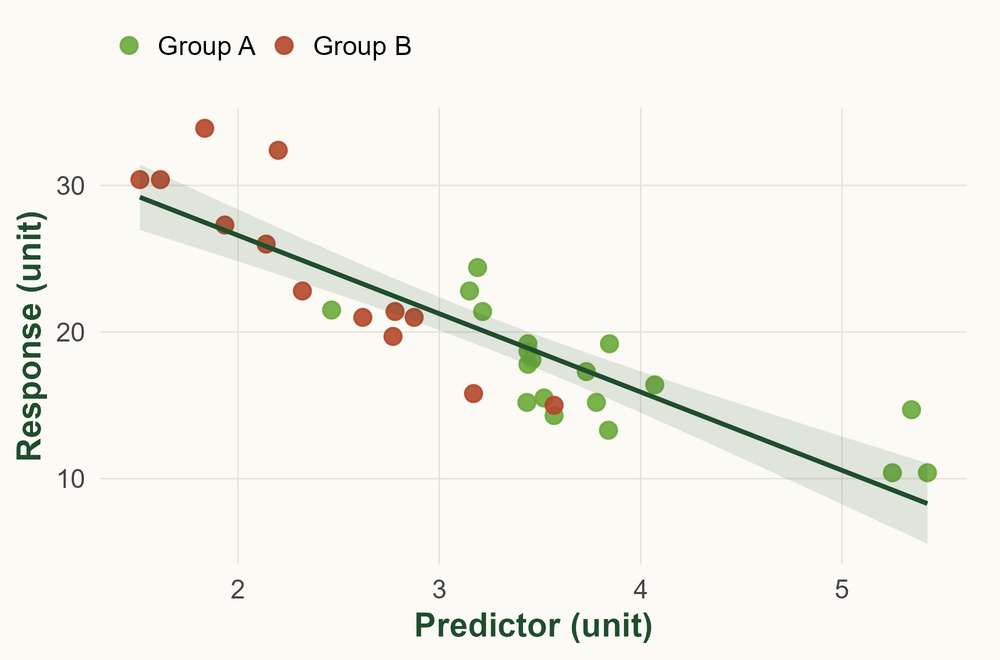

## About Me

:::: {.columns}
::: {.column width="32%"}
{.profile-photo}
:::
::: {.column width="68%"}
### Your Name

[Your institute]{.muted}

- **Position:** ...
- **Research interests:** ...
- **Contact:** ...
:::
::::

::: {.notes}
Speaker notes go here. Press S while presenting.
:::

## Write each title as the point of the slide

::::: {.cards}
:::: {.card}
[Plain card]{.card-title}

Three cards fill a slide better than three bullets.

[Author, 2020]{.cite}
::::
:::: {.card .card-alert}
[Problem card]{.card-title}

Use `.card-alert` for the problem and [.hl]{.hl} to highlight a phrase.
::::
:::: {.card .card-key}
[Key card]{.card-title}

Use `.card-key` for the main idea. `.card-grey` de-emphasises.
::::
:::::

## Objectives

::::: {.cards}
:::: {.card .card-num}
[1]{.num}

First objective, with the **key words** in bold
::::
:::: {.card .card-num}
[2]{.num}

Second objective
::::
:::: {.card .card-num .card-key}
[3]{.num}

The objective that matters most
::::
:::::

## Methods {.section-slide data-num="01" background-color="#1F4E2C"}

## A workflow diagram shows what you did to the data

```{=html}
<div class="workflow">
  <div class="step"><b>Raw data</b><br>what was measured<span class="fn">n = ...</span></div>
  <div class="arrow">→</div>
  <div class="step"><b>Derived variable</b><br>how it was computed<span class="fn"><code>function()</code></span></div>
  <div class="arrow">→</div>
  <div class="step grey"><b>Baseline</b><br>the usual method<span class="fn"><code>lm()</code></span></div>
  <div class="arrow">vs.</div>
  <div class="step key"><b>Your method</b><br>what is new<span class="fn"><code>pkg::fn()</code></span></div>
</div>
```

::: {.text-center .muted}
Software and versions · experimental unit
:::

## Tables get a coloured header automatically

:::: {.columns}
::: {.column width="46%"}
- Site and season
- Design: treatments × replications
- What was measured, and when
:::
::: {.column width="54%" .small-table}
| | Treatment |
|:-:|:--|
| T1 | Control |
| T2 | Treatment description |
| T3 | Treatment description |
| T4 | Treatment description |
:::
::::

## Results {.section-slide data-num="02" background-color="#1F4E2C"}

## State the finding, then show the figure

:::: {.columns}
::: {.column width="60%"}
{width=100%}
:::
::: {.column width="40%"}
- One or two numbers only
- The takeaway, with [the key result]{.hl}

::: {.how}
`lm(response ~ predictor, data = d)`
:::
:::
::::

::: {.notes}
Put the remaining statistics here instead of on the slide.
:::

## One big number per talk

:::: {.columns}
::: {.column width="50%"}
::: {.stat-card}
[33%]{.big-number}

what the number means

[95% CI ...]{.stat-ci}
:::
:::
::: {.column width="50%"}
- Context for the number
- A second supporting number
:::
::::

## Numbered lists get round markers

1. First limitation or step
2. Second
3. Third

## Conclusions

::::: {.cards}
:::: {.card}
[Finding 1]{.card-title}

One sentence.
::::
:::: {.card .card-grey}
[Finding 2]{.card-title}

One sentence.
::::
:::: {.card .card-key}
[Main finding]{.card-title}

The sentence you want people to remember.
::::
:::::

::: {.future}
**Next steps:** what comes after this study
:::

## Thank You {.section-slide background-color="#1F4E2C"}

Questions?

## Backup: full code {.code-slide visibility="uncounted"}

```{.r code-line-numbers="false"}
# Backup slides are not counted in the slide number.
fit <- lm(response ~ predictor, data = d)
summary(fit)
```
